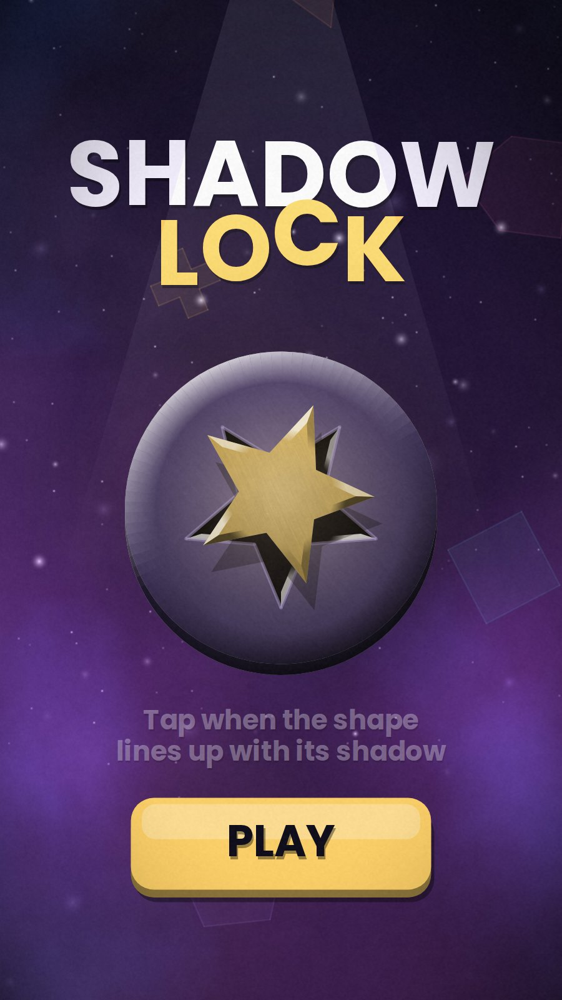
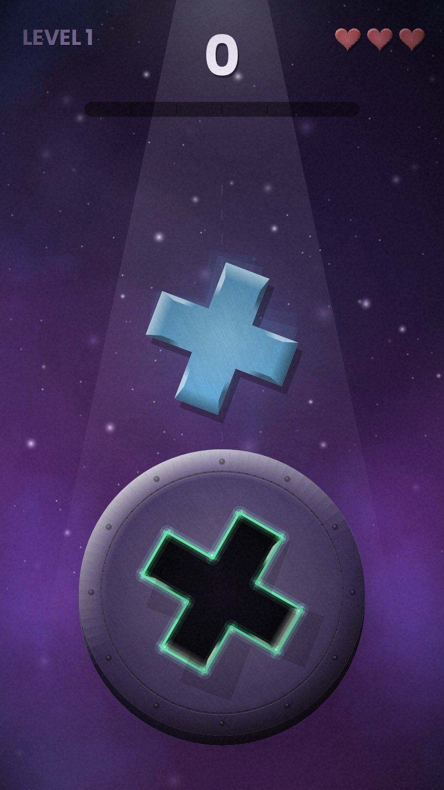
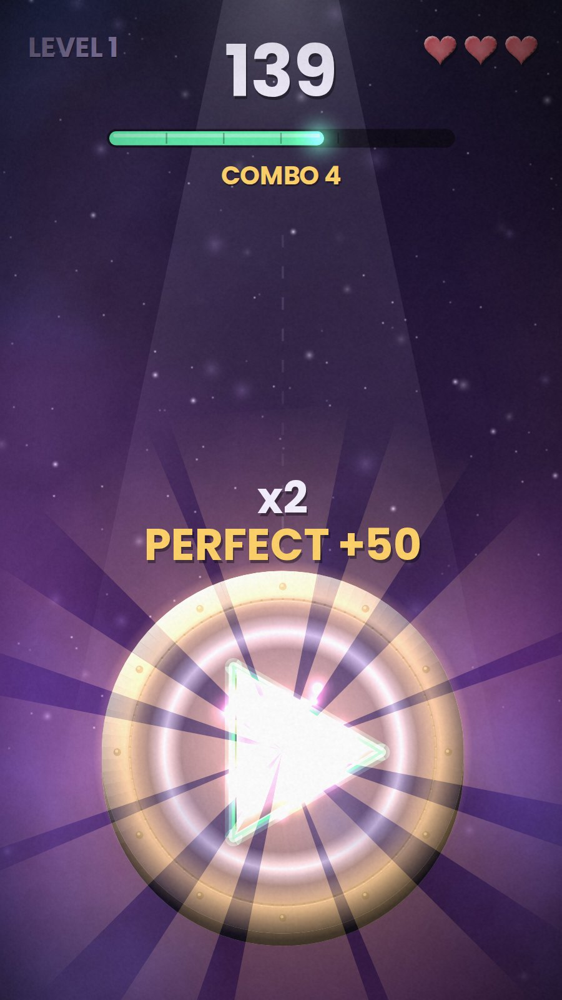
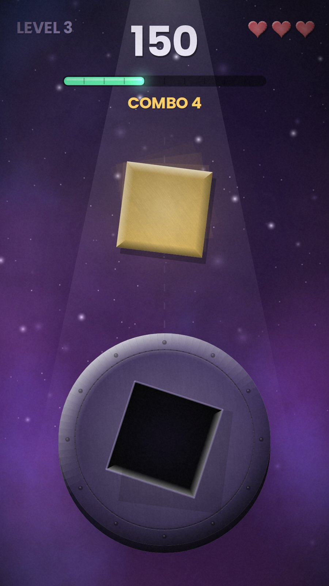
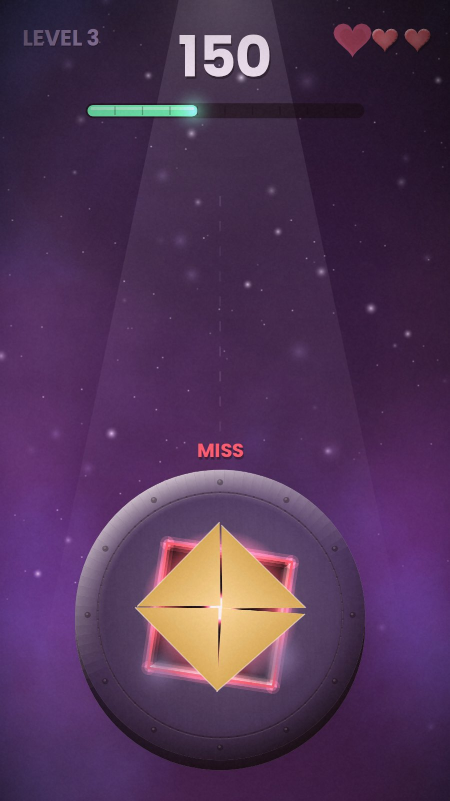
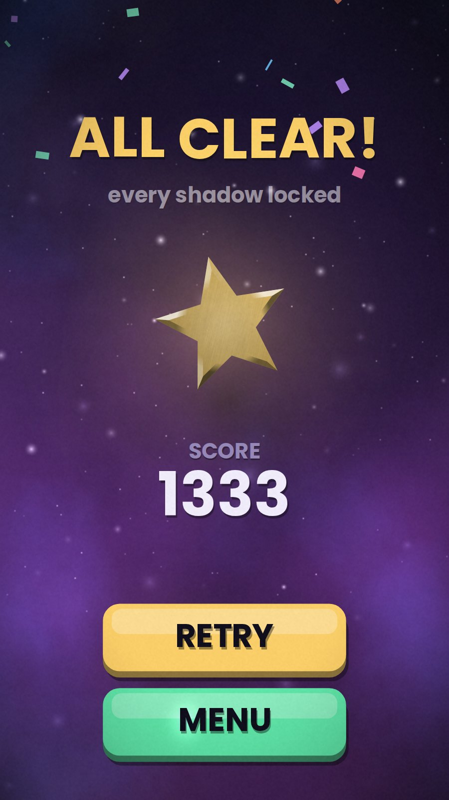

# Shadow Lock

Bir şekil dönerek düşüyor, aşağıdaki plakada gölgesi oyulmuş. Şekil gölgesiyle aynı açıya geldiği an dokun: şekil yuvasına oturur. Kaçırırsan paramparça olur.

Oyun önce GameMaker'da Android (dikey) için yazıldı. Bu depo, aynı oyunun tarayıcıda çalışan TypeScript + Canvas sürümünü ve orijinal GameMaker projesini birlikte içeriyor. Bölümler, şekiller, tolerans ve puan kuralları, sesler, dokular ve yazı tipi orijinaliyle birebir aynı.

| | | |
|---|---|---|
|  |  |  |
|  |  |  |

## Nasıl oynanır

- Şekil dönerken iner. Gölgesiyle hizalandığı an ekrana dokun (klavyede boşluk ya da Enter).
- Hata toleransın içindeysen şekil yerine oturur: +10. Toleransın %35'inden yakınsa **PERFECT**: +25.
- Arka arkaya her 3 kilitte çarpan artar (en fazla ×5). Iskalamak ya da şeklin kendi kendine plakaya düşmesi bir can götürür ve komboyu sıfırlar.
- Simetrik şekiller (üçgen, kare, artı, beşgen, yıldız) bir turda birden fazla kez hizalanır. Ok, ev, uçurtma ve V şeklinde ise tek doğru açı vardır.
- Bölüm geçince bir can geri gelir. Oyunu bitirirsen kalan her can +100.

| Bölüm | Şekil | Dönüş | Tolerans | Hedef | Fark |
|---|---:|---:|---:|---:|---|
| Warm Up | 3 | 90°/sn | 18° | 6 | hizalanınca gölge parlar |
| One Way | 6 | 130°/sn | 15° | 8 | ipucu yok, yön değişebilir |
| Moving Dark | 8 | 150°/sn | 14° | 10 | gölge de dönüyor |
| Heartbeat | 9 | 180°/sn | 13° | 12 | dönüş hızlanıp yavaşlıyor |

En iyi skor tarayıcıda saklanır.

## Çalıştırma

```bash
npm install
npm run dev        # http://localhost:5173
npm test           # 14 test: açı hatası, şekil simetrileri, puanlama, bölüm akışı, baştan sona bitirme
npm run build      # dist/ — statik dosyalar, herhangi bir alt dizinde çalışır
node scripts/screenshots.mjs   # README görüntüleri (Playwright)
```

## GameMaker'dan web'e

Orijinal proje `gamemaker/` klasöründe, GameMaker 2024.x ile açılır. Web sürümü GML kodunu satır satır takip ediyor:

| GameMaker | Web |
|---|---|
| `sl_init` (renkler, şekiller, bölümler), `sl_angle_err`, kayıt | `src/game/state.ts` |
| çizim yardımcıları (`sl_draw_piece`, `sl_draw_socket`, `sl_draw_bevel`, `sl_glow`, yazı, arka plan) | `src/game/draw.ts` |
| `obj_game` Create / Step / Draw | `src/game/game.ts` |
| `obj_start`, `obj_over` | `src/game/start.ts`, `src/game/over.ts` |
| `draw_*`, `gpu_set_blendmode` | `src/engine/gfx.ts` (Canvas 2D, `lighter` karışımı) |
| ses, giriş | `src/engine/audio.ts` (Web Audio), `src/engine/input.ts` (Pointer Events) |

Taşırken çözülen noktalar:

- **Dokulu parçalar.** GameMaker'da her şekil, malzeme dokusu köşe koordinatlarına göre gerilmiş bir üçgen yelpazesi. Web'de şeklin kendisi kırpma alanı yapılıyor, doku aynı UV eşlemesiyle (`0.5 + x·0.47`) döndürülüp ölçeklenerek çiziliyor. Ortası açık, kenarı koyu renk geçişi `multiply` ile üstüne ekleniyor.
- **Kabartma kenar.** Her kenar ışığa (sol üst) göre beyaz ya da siyah bir bantla gölgeleniyor. Yuvalarda aynı hesap ters çalıştırılıyor, böylece yuva oyuk görünüyor.
- **Işık ve parıltı.** `bm_add` karışımı Canvas'taki `lighter` ile birebir karşılanıyor. Halkalar, ışınlar ve ışık hüzmesi radyal ya da doğrusal gradyanla çiziliyor.
- **Vuruş anı donması.** Orijinaldeki gibi kilitte ve ıskalamada oyun kısa bir süre %5 hızla akıyor, sonra devam ediyor.
- **Ekran.** 720×1280 oda, oran korunarak ekrana sığdırılıyor ve yüksek DPI ekranlarda keskin çiziliyor. Telefonda tam ekran oynanıyor.

Testler oyun mantığını tarayıcı olmadan, tohumlu rastgele sayı üreteciyle çalıştırıyor. Test, şekil doğru açıya geldiğinde dokunan bir oyuncu gibi 4 bölümü baştan sona bitiriyor ve skorun kurallara göre çıktığını doğruluyor.

## Teknolojiler

TypeScript, Canvas 2D, Web Audio, Vite, Vitest, Playwright. Oyun motoru ya da çizim kütüphanesi kullanılmadı. Orijinali GameMaker (GML).

## Lisans

Kod MIT, Uğur Can Elsun. Poppins yazı tipi SIL Open Font License 1.1 ile lisanslı (`public/assets/fonts/Poppins-OFL.txt`).
